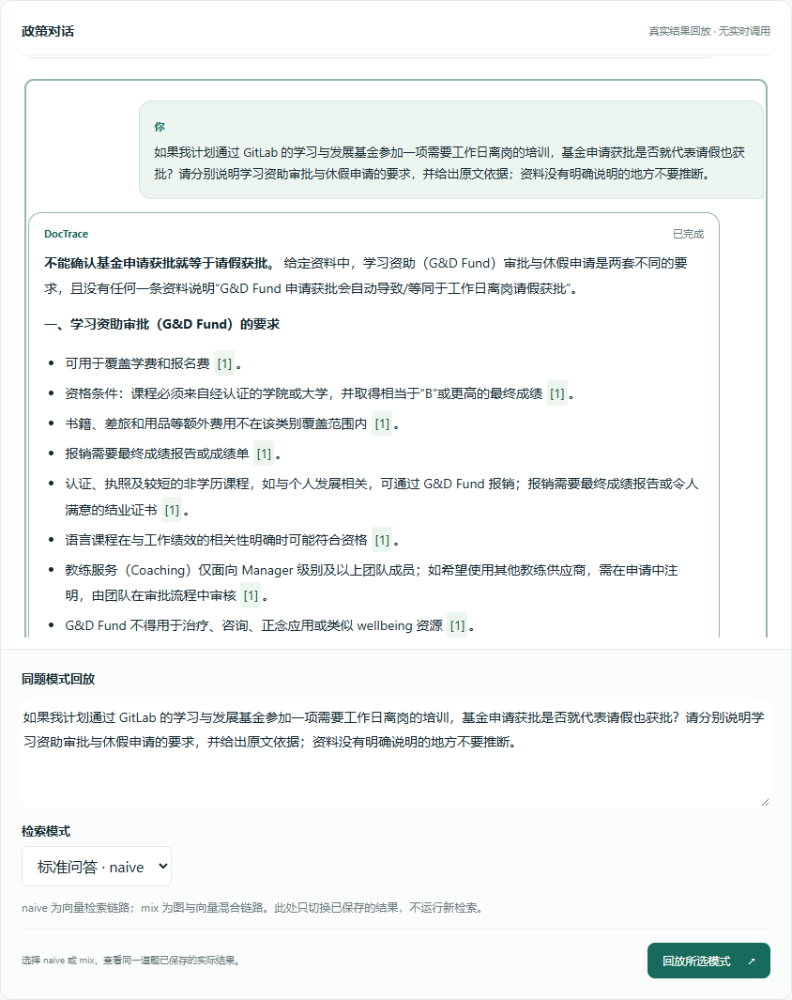
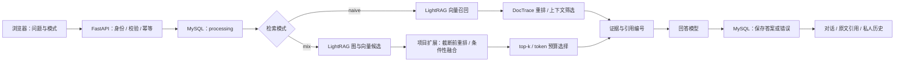

# DocTrace · 企业 HR 政策 RAG 问答与证据追溯系统

[](https://github.com/yaowcui-ai/DocTrace/actions/workflows/checks.yml)

**[在线交互演示](https://yaowcui-ai.github.io/DocTrace/) · [本地运行](guide/local-setup.md) · [架构与代码入口](guide/architecture.md) · [评测证据](evaluation/README.md)**

基于 GitLab 公开 Handbook HR 政策的 RAG 应用开发实践。使用 **Python / FastAPI / LightRAG / BGE-M3 / BGE Reranker / MySQL / Docker / JavaScript**，实现两条检索链路、答案原文引用、对话式展示与个人历史。

> 在线演示为**真实保存结果的免登录回放**，包含同题 naive / mix 结果和 10 条已审核公开示例；支持历史定位、Markdown 和引用展开。演示不进行实时检索、模型生成或账号登录。完整应用源码在本仓库，可按说明配置本地服务运行。

## 项目做了什么

- **知识库：**68 份 GitLab 公开 HR 政策，固定 1,200 token 切分、100 token 重叠；冻结本地索引含 318 个片段、4,179 个节点、5,621 条边。
- **检索扩展：**修改 LightRAG 上下文构建接入位置，在完整候选合并后、top-k / token 截断前进行自定义重排；对明确复合问题使用整句与子问题排序融合。
- **效果核查：**20 道开发题同候选对照，标注证据组覆盖从 **39/45 提升至 44/45**，保留逐题结果和 M19 退化；指标衡量证据保留，不是答案准确率。
- **业务闭环：**Cookie 会话、个人记录归属隔离、问题/知识库/模式绑定的幂等请求，以及 processing → completed / failed 状态持久化。
- **故障定位：**阶段日志区分检索、生成和落库异常；重排失败降级并记录策略元数据。连续对话展示、历史回放不重复调用模型。

## 30 秒查看演示

1. 打开 **[在线演示](https://yaowcui-ai.github.io/DocTrace/)**，默认展示 naive 的已保存回答。
2. 在“同题模式回放”选择 **mix**，查看同题另一条真实结果。
3. 点击回答中的 **[1]**，展开该条回答对应的原文依据。
4. 点击公开示例或左侧“演示历史”，载入并定位相应问答；翻页可查看其他记录。

两种模式在正式应用中每次只运行所选链路。演示切换的是两次已保存结果，不表示系统同时运行两种模式择优回答，也不构成严格控制变量评测。



## 架构与职责



LightRAG 提供基础入库、切分、向量/图索引和检索能力。DocTrace 完成业务编排、候选排序扩展、失败评测、身份和持久化；不声称自研底层框架或训练大模型。聊天界面中的历史回放不自动成为模型的多轮记忆。

## 核心代码

| 文件 | 负责什么 |
| --- | --- |
| [`app/main.py`](app/main.py) | 接口、权限依赖及问答入口 |
| [`app/qa_pipeline.py`](app/qa_pipeline.py) | naive / mix 选择与检索、上下文、生成编排 |
| [`deploy/build_hr_prelimit.py`](deploy/build_hr_prelimit.py) | 从固定镜像提取代码，校验插入点并生成截断前重排接入 |
| [`app/prelimit_adapter.py`](app/prelimit_adapter.py) | 实际重排调用、缓存、审计和降级 |
| [`app/facet_policy.py`](app/facet_policy.py) | 保守子问题拆分与候选去重融合 |
| [`app/recorded_qa.py`](app/recorded_qa.py) / [`app/idempotency.py`](app/idempotency.py) | 短事务记录、请求认领与同键复用 |
| [`app/auth_routes.py`](app/auth_routes.py) / [`app/sessions.py`](app/sessions.py) | Cookie 会话及用户身份 |
| [`app/web/conversation.js`](app/web/conversation.js) | 连续气泡、历史定位、去重与账号切换清空 |

## 本地运行与测试

详细步骤见 **[本地运行说明](guide/local-setup.md)**。实时问答需要 MySQL、Docker 中的 LightRAG、Embedding、Reranker 与回答模型的私有配置；仓库不包含密钥或预构建向量/图索引。重新入库会产生供应商调用费用。

只查看演示，无需配置数据库或密钥：

```bash
git clone https://github.com/yaowcui-ai/DocTrace.git
cd DocTrace
python scripts/serve-demo.py --port 8080
# 打开 http://127.0.0.1:8080
```

离线测试：

```bash
python -m venv .venv
# Windows: .venv\Scripts\activate
# macOS/Linux: source .venv/bin/activate
python -m pip install -r requirements-lock.txt
python -m pytest tests -q
npm ci
npm run test:frontend
```

自动化测试使用临时数据或模拟服务，不是模型效果评测，不会因为打开演示而调用模型。

## 评测结果与边界

| 固定同候选对照 | 原排序 | 整句截断前重排 | 整句 + 条件性子问题 |
| --- | ---: | ---: | ---: |
| 开发集：20 题 / 45 证据组 | 39/45 | 43/45 | **44/45** |
| 内部保留题：12 题 / 26 证据组 | 17/26 | 26/26 | **26/26** |

数据来自同一知识库、小样本内部评测，不能泛化为未知问题表现。保留题中整句重排已覆盖全部标注组，不能将全部收益归于子问题融合。M19 仍有 3/3 → 2/3 的退化；这次改进也未证明降低 token 消耗或缩短延迟。

[查看方法、失败案例、逐题结果和原始压缩证据 →](evaluation/README.md)

## 目录

```text
app/              实际应用后端、评测工具及原生前端
deploy/           固定镜像、截断前接入与私有配置生成脚本
sql/              001–007：建表及有顺序的增量迁移
data/gitlab_hr/   公开政策 Markdown、官方来源与哈希清单
evaluation/       冻结题集、逐题对照及压缩原始证据
tests/            后端、前端和隔离浏览器配套
docs/             GitHub Pages 免登录结果回放（独立于实际后端）
guide/            本地配置、架构与演示边界
```

本仓库不公开个人账号、密码哈希、Cookie 会话、私人问答、运行日志、数据库备份或本机 `.env`。在线示例只包含选定的公开政策问题和已审核快照。

## 来源与致谢

- [LightRAG](https://github.com/HKUDS/LightRAG)：基础检索框架；运行镜像固定到 digest，项目通过生成补丁接入扩展。
- [GitLab Handbook](https://handbook.gitlab.com/)：政策内容按 [CC BY-SA 4.0](https://handbook.gitlab.com/handbook/about/handbook-usage/) 署名与分享；Markdown 保留来源和转换说明。
- BGE-M3、BGE Reranker、FastAPI、SQLAlchemy、MySQL、Docker、Marked 和 DOMPurify。第三方许可见 [THIRD_PARTY_NOTICES.md](THIRD_PARTY_NOTICES.md)。

本项目是个人学习与工程实践作品，不是 GitLab 官方产品，也不代表其当前有效人事政策。
