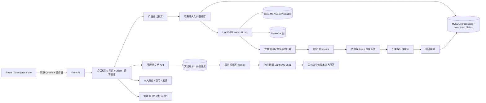

# DocTrace 升级架构

## 运行边界

这是在原项目上的增量单体升级。原 `app/web`、`/ask/optimized`、MySQL 历史与 LightRAG 策略模块保留。React 位于 `/workspace/`；原界面仍在 `/`。升级验收使用独立 `doctrace_upgrade` 数据库（3310）和 8005，不覆盖旧 3306/8001。

## 代码职责

| 路径 | 职责 |
|---|---|
| `frontend/src/App.tsx` | 工作台、登录、个人会话、引用、反馈、文档与评测页面 |
| `frontend/src/state.ts` | 账户代际隔离、同源 API、刷新恢复、固定操作键 |
| `app/main.py` | 生命周期、静态资源、旧 API 兼容与路由整合 |
| `app/product/api.py / schemas.py` | 版本化 Pydantic 契约、身份/角色依赖、安全响应 |
| `app/product/service.py` | 会话归属、有界上下文、消息与既有 QA 关联 |
| `app/product/repository.py / tables.py` | 会话、消息、反馈、角色和知识库选择存储 |
| `app/recorded_qa.py / qa_records.py` | 短事务、先存 processing、账号级幂等、结果保存与复用 |
| `app/qa_pipeline.py` | 冻结库检索、重排、证据选择、生成与阶段失败 |
| `app/prelimit_adapter.py / facet_policy.py` | 容器内自定义策略、缓存、保守子问题融合与降级 |
| `app/knowledge/` | 文档版本、任务、上游身份校验、顺序处理与状态跟踪 |
| `app/managed_query.py` | 托管库检索与生效源白名单过滤、版本检查和生成 |
| `app/security_limits.py` | 有界登录窗口、全局 2 / 每账号 1 个付费在途任务 |
| `app/upgrade_reports.py` | 管理员读取固定白名单报告，禁止任意路径访问 |
| `app/upgrade_setup.py` | 显式隔离初始化和增量表创建，不启动时修改旧库 |

## 问答生命周期

1. 验证 Cookie、预期账号、Origin、UUID 操作键、问题、模式、知识库与会话归属。
2. 在短事务中保留消息与操作归属，保存用于检索的有界问题上下文。只带同知识库最近两条用户问题，不把旧答案当政策依据。
3. 复用既有账号级 QA 认领。同键改问题、会话、模式或知识库返回 409；已保存结果回放不再调用模型。
4. 新工作先保存 processing。付费阶段进入有限并发槽，检索、重排、筛选、生成均在数据库事务之外运行。
5. 证据不足明确返回，不凭一般政策推断个人记录。托管库先排除非生效/旧版/停用源。
6. 使用短事务保存答案、引用、策略和状态；新消息与原 QA 对应。保存失败不能声称结果已持久化。
7. 引用只从已授权 QA 的保存快照读取；客户端文件名不用于读取服务器磁盘。

## 知识库写入与读取隔离

冻结 v3 不用于上传。托管库固定专属端口 9631、工作空间 `doctrace_managed_v1` 与服务密钥，写入前核对标题和工作空间。仅管理员可上传/更新/排队/停用；企业共享的生效托管政策对已登录用户可问答，不是多租户任意知识库。

上传成功仅表示文档保存；排队也不是索引完成。Worker 单步提交后保存 track ID，再轮询 processed。提交未知不自动重复；新版本 processed 后才切换生效版本并安排清理旧版。检索还必须按生效源过滤，防止后台尚未清除的旧向量影响答案。

## 关键限制

- 未实现真实模型流式输出；前端等待完整已保存答案，不伪装打字动画为流式。
- 有界历史问题是基础多轮支持，不是经过完整评测的智能指代解析器。
- 并发配额和登录限流是单进程保护；多 worker 部署需共享协调方案，本机默认只启动一个 worker。
- 进程硬崩溃后的未确认任务需要核对恢复；不自动重复可能已发生的付费调用。
- 固定版 LightRAG 原生也支持截断前重排。自定义挂钩的存在不等于该排序位置是原创算法。
- 外部模型别名不等于可验证的不可变权重版本；快照、代码哈希、参数及实际返回均需记录。
