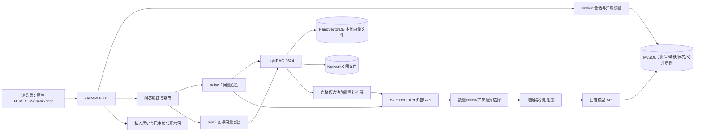

# DocTrace 升级审计（2026-10-28）

本文件记录升级开始时的实际状态；后续实现另写验收记录，不倒写历史成果。没有购买服务、重建冻结索引或覆盖旧报告。

## 1. 仓库与版本证据

- 本地应用 `doctrace/` 属于父目录 Git 仓库，起始分支 `codex/doctrace-development`，HEAD `00d258a`。大量应用文件仍为未跟踪文件，父仓库近期提交主要属于另一个项目；不能把父仓库历史当成完整 DocTrace 开发历史。
- 独立公开发布副本在 `../output/DocTrace-public-20261021/`，远端 `https://github.com/yaowcui-ai/DocTrace`，本次 `git ls-remote ... HEAD` 实测 `6512783c21d6cabff8edbca0ccba373e6764a0ea`，只有一次整理发布提交。这能证明发布内容，不能补造开发过程提交。
- 已在本地父仓库和独立发布副本分别新建 `codex/doctrace-fullstack-upgrade`。既有脏文件原样保留，不执行全工作区 add、reset、clean 或批量数据库迁移。
- 邻接 `../LightRAG` HEAD `4d0afc1bc36e6a34d4a5895b68efe9413748627a`，工作区无差异。实际服务器用固定镜像 digest，而非直接运行这个源码工作区。

## 2. 实际系统架构

Embedding 使用 BGE-M3（1024 维），由供应商 API 计算。MySQL 存业务数据，NanoVectorDB 存向量，二者用途不同。GitHub Pages 是结果回放，不是在线模型服务。

## 3. 模块与功能盘点

| 模块 | 已验证存在 | 缺口 / 改造方向 |
|---|---|---|
| 前端 `app/web/` | 登录、对话气泡、引用、模式、历史定位、刷新恢复、公开示例 | 非 React；气泡不代表真正多轮上下文；无工作台、搜索、反馈、管理页面 |
| API `app/main.py` | 同步 ask、优化 ask、个人记录列表/详情、健康检查 | 入口集中；没有版本化产品 API、会话模型、角色、管理任务接口 |
| 认证 `auth_* / sessions.py` | HttpOnly/SameSite Cookie、令牌哈希、过期/撤销、Origin、账号绑定 | 无登录限流；新密码被限制 6–10 位；没有管理员角色 |
| 存储 `qa_records.py / recorded_qa.py` | processing 先提交、短事务、账号级幂等、结果复用 | 无会话/消息/反馈表；进程崩溃后 processing 可能永久悬挂 |
| 检索 `qa_pipeline.py` | naive 与 mix，证据组装、上下文筛选、阶段错误 | 两链预算并不一致，不能直接作为公平算法对照 |
| 重排 `prelimit_adapter.py / facet_policy.py` | 完整候选重排、保守规则拆分、缓存、降级元数据 | 不能召回候选池外证据；冷调用慢；分支策略并非所有问题有效 |
| 文档 `corpus.py / ingest_hr_v2.py` | 来源清洗、CLI 入库、LightRAG 管理页 | 应用没有上传/更新/任务状态/角色隔离；在线写入会污染冻结实验库 |
| 部署 `deploy/` | 固定镜像、索引目录隔离、优化挂载、恢复记录 | 依赖兄弟目录 `.env`、私有补丁与索引；不是干净机器一键启动 |
| 测试 `tests/` | 大量离线 Python、JS、权限及浏览器辅助脚本 | 根目录 pytest 会递归备份；缺 React E2E、产品 API、上传与角色测试 |

## 4. LightRAG 原版差异边界

原版运行镜像：`ghcr.io/hkuds/lightrag@sha256:5bdbd524931b011df246fe20888d110cef691e6804c12cde636a2b746d7de27e`。

`deploy/build_hr_prelimit.py` 从该镜像提取 `/app/lightrag/operate.py`，只在唯一匹配边界注入：

1. `merged_chunks` 已完整合并后，调用 `doctrace_ext.prelimit_adapter.apply_policy`。
2. 通过 `asyncio.to_thread` 执行同步扩展，得到重排后的完整候选和元数据。
3. 将 `policy_chunks` 传入上游 `process_chunks_unified`，随后仍由原框架执行 top-k/token 选择及引用组装；成功启用时关闭重复的框架重排。
4. 将 `doctrace_policy` 写入响应 metadata，记录策略、调用与降级。

本地构建清单 `runtime/hr_prelimit/build.json` 记录原版 SHA256 `fecb70d27b860efacb57d7b1bc16a706d7d68bd18de9ac80571fcd4628305047`，补丁 SHA256 `f5434407616c44ccef5b81947b7915b5a196b5d7b448f7faaec418e10062933a`。这两个值是已有构建记录，须用本次重新提取/比对验收才能证明现运行字节一致。

没有改写 Embedding 算法、图检索算法或训练模型。B0 必须使用相同 digest 原码和配置；“本地源码 checkout 未修改”不能否认容器补丁，也不能替代原版对照。

**本轮新增关键发现：**固定镜像对应的 `utils.py::process_chunks_unified` 本身按“原生重排 → 分数过滤 → chunk_top_k → token 截断”执行（归档源码 `evaluation/diagnostics/20261016T044508Z_38dfaa7a_utils.py.txt:6295`）。因此不能声称该框架原版一定先截断再重排。旧对照关闭了原生重排，39/45→44/45 只能支持对该配置的收益，尚不能证明自定义方案优于原生重排。新 B1 必须加入并明确阈值、top_n 和供应商适配差异；若 B1 与 B2 在相同输入和阈值下等价，应如实报告等价。

## 5. 实验可核查结论

- `data/gitlab_hr/v3/BUILD_STATUS.json`、`build_configuration.json`、`index_acceptance.json` 记录 68 文档、318 片段、4179 节点、5621 边，1200 token / 100 overlap。需将来源、清洗内容与索引 hash 一同冻结。
- `evaluation/MEDIUM_EVALUATION_REPORT_20261016.md`、`diagnostics/hr_medium_policy_dev_verified_20261016.json` 支持：20 开发题 45 证据组，原排序 39/45，整句前置重排 43/45，最终条件性融合 44/45。
- 保留题 12 道 / 26 组：17/26 → 26/26；整句重排已达 26/26，不能声称子问题额外贡献。题目由同一助手在同一库生成，不是外部盲测。
- M19 从 3/3 退化至 2/3，必须保留。旧 `hr_holdout_v1` 用于改提示后已转回归，不能再次充当独立测试。
- 以上是检索代理指标，不是答案正确率，也不是用户任务效率。旧报告、冻结与失败文件不覆盖。
- 新实验缺独立冻结测试、完整相关性标签、Recall/MRR/nDCG、答案人工核验、受控性能、安全注入实测、模拟业务基准。未知标签不能当作“不相关”。

## 6. 首轮实际执行

`python -m pytest -q --junitxml=evaluation/upgrade_baseline_20261028.xml`：退出 1，98 collection errors。原因是递归 `backups/20261017/snapshot/tests`，同名测试模块冲突。不是 98 项业务功能失败。已保留 XML；接着使用明确的 `pytest tests` 路径建立基线，结果补入独立运行报告。

后续基线实跑：本地 `pytest tests -q` **938 passed**（38.54s）；原 JS **86 passed**；公开发布副本 `pytest tests -q` **938 passed**（41.65s）。这些是离线测试通过，不能推断干净机器有模型密钥或已构建知识库。新增 `pytest.ini` 仅限定测试发现目录，不删除旧备份。

本次从固定镜像提取原码并与实际运行容器、构建文件比较，原码哈希与清单吻合，容器补丁与生成文件字节一致；68 份清洗/原始文档哈希亦通过。证据：`evaluation/upgrade/20261028T023825Z_audit_06809179/audit.json` 及同目录 `operate.patch`。供应商调用 0。

公开仓库能获得源码与公开文档；README 已明确不是从空机器一键启动。当前审计不将“公开代码存在”写成“干净环境完整 AI 问答已复现”。

## 7. 安全、性能、架构风险与优先级

| 优先级 | 风险与证据 | 处置 |
|---|---|---|
| P0 | 不能让上传、更新或实验覆盖 v3/旧 DB | 冻结 v3；开发/集成/可写库隔离；增量建表，显式迁移 |
| P0 | 没有管理角色，新增管理 API 若只登录即开放会越权 | 角色表、默认普通用户、后端校验，权限集成测试先行 |
| P1 | `users.py:8-9` 短密码上限；`auth_routes.py` 无登录限流 | 保留老账号可登录，允许长密码、增加有限容量限流 |
| P1 | `main.py:145-148` 只有网络空闲超时，无总链路期限/并发准入 | 有界并发、阶段记录；不要把线程池当无限队列 |
| P1 | 崩溃后 processing 无恢复 | 显式状态与人工可追踪处理；不自动重试付费生成 |
| P1 | 文件上传/引用/报告读取新入口的路径穿越与跨用户风险 | UUID/白名单 ID、受限扩展和大小、权限先校验、引用按已授权消息读取 |
| P2 | API 与大页面耦合 | 增量 router / service / repository，旧接口不破坏；React 独立构建并同源部署 |
| P2 | 冷重排可达数十秒 | 记录 P50/P95、并发和缓存条件，先少量再扩大，不虚构提速 |

## 8. 选择与阶段计划

推荐增量单体：保留旧接口和页面，新增 `/api/v1` 产品 API、React 工作台、独立增量表；保留 LightRAG 服务。另两个方案是继续原生 JS（不满足 React 目标）或重写/微服务化（迁移风险与资源开销更大），均不采用。

1. 审计与基线：本文件、版本/差异/哈希、测试失败和重新验证记录。
2. 产品基础：角色、会话、消息、个人搜索、反馈、React 实际接 API；旧入口保留，失败与幂等可复查。
3. 知识库管理：独立可写库；上传/更新/撤销/重建任务与状态；后台任务只顺序处理，持久化状态，不引入分布式队列。
4. 评测基础：冻结 corpus/算法/题集版本；分主题分组避免近义泄漏，机器辅助候选与人工审核状态分开。100–150 是目标，不凑数量。
5. 实验执行：先离线重放 B0/B1/B2/B3 和安全/性能小规模验证；真实在线检索及少量生成另记调用预算、失败和限制。
6. 交付：Compose、离线 CI、安装启动与演示、工程/业务/实验报告、逐条对应证据的简历材料。未运行项明确“未完成”。

本审计不承诺所有扩展在一次修改中完成。每项能力以代码、实际运行和报告验收，不用文档勾选代替实现。

## 9. 升级执行核查（2026-10-29）

新增React真实API工作台、产品API与表、角色/会话/引用隔离、托管版本与顺序任务、请求聚合统计及隔离Docker交付。具体完成/限制以ARCHITECTURE、ENGINEERING_TEST_REPORT、EVALUATION_REPORT为准，不由本审计推断生产就绪。

镜像label revision实际为 `28ff1b05f2ac3f3e6fa14dd2cd33656579bd0c9c`，不能拿相邻checkout的4d0afc当运行原版。原生utils先重排再数量/token截断，109道新可评题中B1/B2同序，B3本轮无额外收益。旧39/45→44/45仍保留为开发证据。

二次安全复核修正了跨库同键关联、导入抢占在途记录和版本变化竞争；前端修正100条限制、内容搜索、反馈和草稿恢复。测试和失败日志均保留；没有改动冻结7个策略文件或旧语料。
